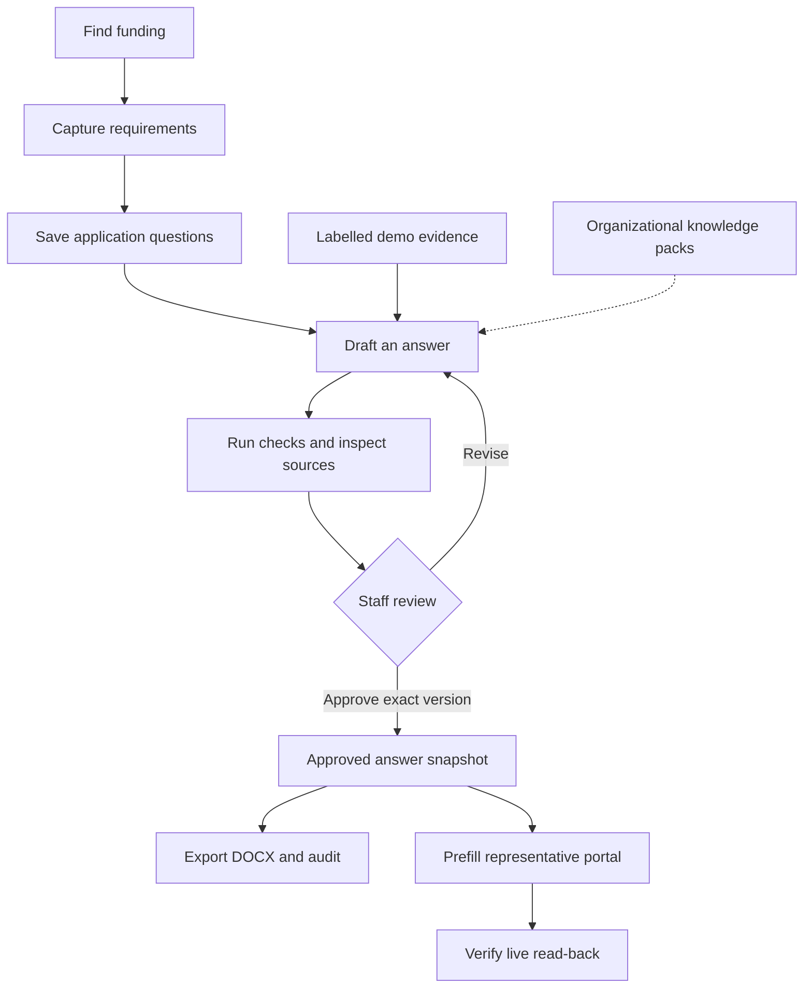
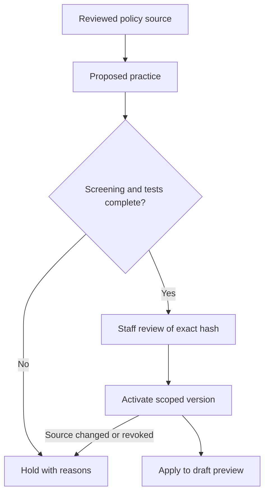
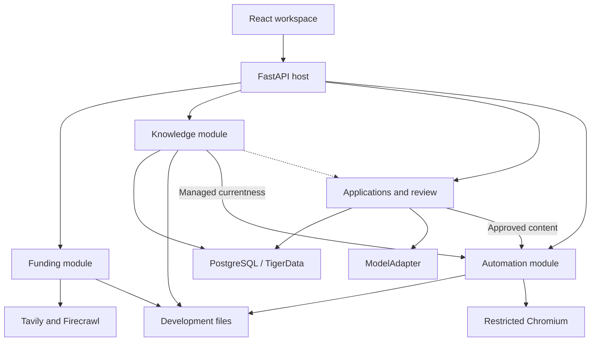

# Strong Start Agent

### Grant writing with evidence, review and reusable organizational knowledge.

[](https://github.com/thegeekyqazi/strong-start-agent/actions/workflows/ci.yml)


**Strong Start Agent is a modular grant-writing workspace built for the Strong Start challenge at CommuniHacks.** It brings funding discovery, captured requirements, organizational evidence, proposal drafting, staff review and assisted form entry into one workflow.

The central requirement is accuracy: a persuasive proposal with an incorrect figure can damage the organization submitting it. Staff need to see which source supports a claim, whether that source is current enough for the question, and what still needs review.

**Models propose content. Application code checks versions and permissions. Staff approve exact answers.**

[Quick start](#quick-start) · [Workflow](#the-workflow) · [Feature status](#what-works-today) · [Architecture](#architecture) · [Practice generator](#practice-generation-c4) · [Documentation](#documentation)

> **Development snapshot:** checked against merged DATA-001 on November 8, 2026. This is a hackathon prototype with implemented modules, labelled demo paths and remaining integration work. See the [current feature matrix](docs/coordination/feature-status.md) for detailed boundaries.

## Why this project exists

Grant preparation repeatedly asks staff to find opportunities, understand a funder's priorities, gather figures from scattered documents and reshape similar answers for different forms. Older reports and previous applications are useful, but their dates, qualifications and context matter.

Strong Start Agent is designed to reduce that repeated work while keeping the evidence attached:

- **Find relevant funding:** search public terms, capture selected pages and record source-backed requirements.
- **Bring organizational knowledge together:** ingest documents and organize versioned facts, passages and knowledge packs.
- **Draft for the actual application:** use saved questions and preserve conflicting or unclear limits.
- **Make review actionable:** show findings, sources, unsupported claims and the next decision staff need to make.
- **Protect approved work:** bind approval to exact content and dependencies, then check currentness before another action.
- **Reuse organizational practice:** develop source-linked writing practices from reviewed policies and private playbooks.

The repository does not claim measured staff-time savings or guaranteed proposal quality. Those require evaluation with Strong Start's real workflow.

## The workflow



**The dotted connection is remaining integration work:** the normal Applications workspace currently uses labelled synthetic evidence. Knowledge ingestion/retrieval and managed A4 evidence paths exist, but the general connection to organizational evidence and writing policy is still being completed.

Form automation currently targets a registered representative portal. It does not submit, sign or upload an application to a real funder.

## What works today

“Implemented” describes the specified capability, not unrestricted production availability.

| Capability | Current state | Important boundary |
| --- | --- | --- |
| Funding search and capture | Implemented Tavily/Firecrawl adapters, source labels and stored capture versions | Live calls require keys; fixture mode is explicitly labelled. Search results do not certify eligibility. |
| Funding cases and requirements | Versioned cases, exact captured quotes, staff review and deterministic comparisons | Unclear deadlines, scope and conditions remain visible; reports do not declare the organization eligible. |
| Application intake | Saved question definitions with wording, order, evidence and limit conflicts | Ambiguous limits remain held rather than guessed. |
| Knowledge foundation | Text/PDF ingestion, evidence retrieval, versioned facts and source/numeric validation modules | Source artifacts use development storage; normal drafting integration remains incomplete. |
| Drafting and checks | Gemini adapter and explicit deterministic fixture adapter; fact-slot rendering and visible findings | Model output is a proposal. The normal workspace's evidence is still synthetic. |
| Review and approval | Exact-version decisions, notes, reviewer proposals and live stale-state checks | The local fixture identity is not production authentication. |
| Application persistence | Durable PostgreSQL answer/review/export/audit state | Explicit backend selection; database failure does not switch to an empty memory store. |
| TigerData | Hosted migration, restricted-role, restart and separate-service restore checks recorded | Provider TLS-root acceptance remains an operator gate; see the [TigerData guide](docs/setup/tigerdata.md). |
| Pack replacement | Real A4 activation, dependency registration and managed currentness checks | Full propagation across every answer/export/skill consumer remains unfinished. |
| Export | Working/reviewed DOCX and JSON audit, exact stored bytes and hashes | Reviewed export requires its approval/evidence gates. Synthetic content retains its labels. |
| Approved prefill | Exact approved C content, guarded plan/grant registration and Chromium read-back | Registered local portal only; B records and execution claims remain development-only. |
| Practice generation — C4 | Next feature increment; thin generation/review/draft-preview flow under development | Not merged in this snapshot. See [C4's intended scope](#practice-generation-c4). |
| Monitoring and deployment | Manual saved-search rechecks exist; broader jobs and deployment remain future work | No production-ready authentication or autonomous submission claim. |

## How accuracy is handled

The system separates a claim, its supporting material and the authority to act on it.

| Mechanism | Why it matters |
| --- | --- |
| Versioned source captures and hashes | A citation can be traced to the content that was actually saved. |
| Exact source passages and locators | Staff can inspect the surrounding evidence instead of trusting a model's summary. |
| Typed facts and server-rendered fact slots | Numeric values can come from resolved evidence instead of being freely rewritten by the drafting model. |
| Exact decimal comparisons and explicit scope | Equal-looking values are not interchangeable when currency, reporting period or population differs. |
| Visible uncertainty and held fields | Missing prerequisites and contradictory instructions do not become invented answers. |
| Content/dependency snapshots | An approval identifies the answer and evidence versions that staff reviewed. |
| Action-time currentness checks | A historical approval cannot automatically authorize a new action after relevant changes. |
| Human review | Staff accept or reject content before reviewed export or assisted entry. |

Implemented findings record what was checked, the relevant evidence/version, the result and a useful next action. Source references and plain-language explanations make decisions inspectable; agent agreement is not treated as proof.

The engineering baseline contains an [86-check catalog](docs/engineering/StrongStart_Check_Catalog.json). **A listed check is not a claim that it has been implemented or passed.** Rule status and task-specific evidence are recorded separately.

### What changes after approval?

Saving a newer answer makes its older approval unusable. Question revisions and relevant dependency changes are checked before use. In the managed A4 path, replacing a knowledge pack can stale registered pending plans and grants.

Historical records remain available as history. A completed browser receipt can be read again without launching a second browser execution.

## Pluggable knowledge, with honest provenance

Strong Start's private brand playbook, standard writing and successful applications are the materials that could make this workflow especially useful. The architecture keeps their ingestion and evidence interfaces separate from the drafting model.

Knowledge inputs retain their identity and meaning:

- **Public:** material obtained from public sources.
- **Supplied:** material shared for the project, with its original context and permissions.
- **Simulated:** explicit demonstration data for information that is missing or private.
- **Engineering-derived:** generated records such as checks, mappings and receipts.

Versioned packs allow a new set of facts, sources or policies to be selected without rewriting the entire application. Replacing a pack does not certify that its contents are correct or current; provenance, review and consumer currentness still matter.

The current implementation establishes these boundaries. Connecting the normal drafting workspace to the complete real-evidence/policy path is an explicit remaining milestone.

## Practice generation (C4)

**In development:** turn a reviewed organizational policy into a small, reusable writing practice with visible supporting evidence.



The thin C4 increment targets terminology and protected-name rules, exact source excerpts, deterministic compilation, screening records and staff activation. The first integration is a **working draft preview on the Skills page**. Applying practice dependencies throughout saved answers, approvals, exports and prefill is later work.

Generated practices have no authority to add tools, access credentials, approve answers or submit applications. They contain restricted text/typed rules, not generated executable scripts. Incomplete screening holds activation; a classifier's “no flags” result is one review signal, not a safety guarantee. Packages do not automatically install themselves into coding agents.

The intended demonstration uses a clearly labelled synthetic policy when the real private playbook is unavailable, then shows how another reviewed source changes the proposed practice.

## Architecture



The dotted edge is the remaining general knowledge-to-drafting connection. Development files include source/capture artifacts and B's local records; moving C's review state to TigerData does not make those files durable across deployments.

| Layer | Technology / role |
| --- | --- |
| Interface | React, TypeScript and Vite; Funding, Knowledge, Applications, Review, Automation and Skills feature entry points. |
| API | FastAPI and Pydantic; server-owned authorization, workflow gates and typed errors. |
| Persistence | PostgreSQL/TigerData, SQLAlchemy, Psycopg and Alembic. |
| Shared contracts | Pydantic → JSON Schema → generated TypeScript; drift checked in CI. |
| AI | ModelAdapter with Gemini and an explicit deterministic fixture adapter. Additional backends are planned. |
| Discovery/capture | Tavily and Firecrawl adapters with bounded operations and explicit availability. |
| Browser | Playwright/Chromium for inspection and restricted selected-field entry/read-back. |
| Verification | Pytest, Vitest, real PostgreSQL tests and real Chromium tests. |

## Quick start

### Prerequisites

- Python **3.12**, [uv](https://docs.astral.sh/uv/) and Git.
- Node.js **22.22.2+ within the supported Node 22 line** and npm; the repository also declares additional supported Node ranges in `package.json`.
- Docker with Compose for local PostgreSQL.
- GNU Make for the commands below. See the [setup guide](docs/setup/README.md) for underlying commands.

### 1. Clone and install

```bash
git clone https://github.com/thegeekyqazi/strong-start-agent.git
cd strong-start-agent
make bootstrap
```

`make bootstrap` installs locked dependencies and creates `.env` from `.env.example` only when `.env` does not already exist.

### 2. Select the local demo explicitly

Edit the ignored `.env`, retaining the example local database URL and other defaults:

```dotenv
STRONGSTART_ENVIRONMENT=local
STRONGSTART_AUTH_MODE=fixture
STRONGSTART_ANSWER_STORE_BACKEND=postgres
STRONGSTART_DATABASE_PROFILE=local
STRONGSTART_MODEL_PROVIDER=fake
STRONGSTART_FUNDING_SEARCH_MODE=fixture
STRONGSTART_FUNDING_CAPTURE_MODE=fixture
```

This selects labelled synthetic providers and the local demo identity. The default `AUTH_MODE=none` refuses protected operations. The fixture identity and fixture providers are rejected in production configuration.

### 3. Start the database and seed demo metadata

```bash
make db-up
make migrate
make seed-demo
```

Local PostgreSQL is exposed on `127.0.0.1:55432`. `make migrate` applies the current Alembic head; this snapshot includes `0009_durable_applications`.

For browser inspection/prefill, install Chromium once:

```bash
make browser-install
```

Some Linux systems also need Playwright's system dependencies; see the setup guide and CI configuration.

### 4. Run the application

In one terminal:

```bash
make dev-api
```

In a second terminal, from the same repository:

```bash
make dev-web
```

| Service | Address |
| --- | --- |
| Web workspace | <http://127.0.0.1:5173> |
| API | <http://127.0.0.1:8000> |
| Liveness | <http://127.0.0.1:8000/health/live> |
| Readiness | <http://127.0.0.1:8000/health/ready> |
| Capability status | <http://127.0.0.1:8000/api/capabilities> |

Readiness checks connectivity and the required migration. Capability status distinguishes available, fixture-only, unimplemented and unavailable operations.

### 5. Enable live integrations when needed

Keep keys in the server environment or ignored `.env`. Choose the provider/model supported by the configured account.

| Integration | Configuration |
| --- | --- |
| Gemini drafting | `STRONGSTART_MODEL_PROVIDER=gemini`, `STRONGSTART_GEMINI_API_KEY`, `STRONGSTART_GEMINI_MODEL` |
| Tavily search | `STRONGSTART_FUNDING_SEARCH_MODE=live`, `STRONGSTART_TAVILY_API_KEY` |
| Firecrawl capture | `STRONGSTART_FUNDING_CAPTURE_MODE=live`, `STRONGSTART_FIRECRAWL_API_KEY` |
| TigerData | Follow the [connection, roles, TLS and recovery guide](docs/setup/tigerdata.md); use the explicitly selected target/profile. |

Missing keys produce an unavailable capability, not a silent switch to demo results. Current model routing restricts permitted data classes; permission to store a document does not automatically permit sending it to every provider.

## Try the connected demo

Use the [integration manual guide](docs/handoffs/integration/int-001-manual-test-guide.md) and [durable-state guide](docs/handoffs/data/data-001-manual-test-guide.md) for exact preparation and expected results.

1. **Funding:** search/capture a page and inspect its source label and captured version.
2. **Automation:** import and save the application questions; inspect conflicting or unclear limits.
3. **Applications:** select that exact saved question set, draft and inspect the evidence/findings.
4. **Review:** save an answer version and review its exact content before approval.
5. **Export:** download a working draft or a reviewed document when all applicable gates permit it.
6. **Prefill:** hand selected approved answers to the representative portal and inspect the Chromium read-back receipt.
7. **Change:** edit an approved answer and show that the old approval cannot authorize a new operation.
8. **Restart:** reopen the durable answer/approval state; prepare a new plan rather than replaying an old pending browser operation.

The browser receipt demonstrates local selected-field entry. The ephemeral page closes afterward; it is not proof of a saved funder application or a final submission.

## Verification

Use focused checks while developing and the appropriate integration checks for a release checkpoint:

| Command | Coverage |
| --- | --- |
| `make check` | Formatting, lint, types, default tests, contract drift and builds. |
| `make smoke` | Local migrations/seed, real PostgreSQL tests and API health checks. |
| `make browser-smoke` | Web build and real Chromium tests. |
| `make contracts` | Regenerate JSON Schema and TypeScript after changing Python contracts. |
| `make tigerdata-smoke` | Explicit hosted verifier; requires private target configuration and phase arguments from the TigerData guide. |

`make smoke` includes migration and synthetic seed steps. Hosted verification uses its own explicit target-selection procedure; do not treat local smoke commands as a generic cloud reset/setup script.

The merged DATA-001 evidence records hosted migration, restricted runtime-role checks, separate-process currentness, API restart and backup/restore into a separate service. Real Chromium evidence is recorded separately from hosted API checks. The remaining TLS-root acceptance and unexercised managed recovery features are documented in the [operator guide](docs/setup/tigerdata.md#hosted-evidence-2026-11-08).

Verification records describe specific inputs and environments. They are not a claim that model-generated prose, all external websites or every catalog rule have been verified.

## Repository guide

| Path | Responsibility |
| --- | --- |
| `apps/web/` | React workspace and feature interfaces. |
| `services/api/` | API, feature services, model adapters, validation and persistence. |
| `packages/contracts/` | Shared Python models, JSON Schema and TypeScript types. |
| `migrations/` | Reviewed, sequential Alembic schema history. |
| `infra/` | Local development PostgreSQL configuration. |
| `scripts/` | Verification, rehearsal and operational tooling. |
| `tests/` | Contracts, unit/integration, PostgreSQL, browser and labelled fixture tests. |
| `docs/` | Engineering baseline, specs, decisions, handoffs and setup. |

## Documentation

| Start here | Purpose |
| --- | --- |
| [Local setup](docs/setup/README.md) | Environment, ports and underlying developer commands. |
| [TigerData guide](docs/setup/tigerdata.md) | Hosted connection, roles, verification, recovery and remaining operator gates. |
| [Current feature status](docs/coordination/feature-status.md) | Implemented behavior and known boundaries. |
| [Engineering plan](docs/engineering/StrongStart_Engineering_Plan.md) | Architecture, trust model, practice generator and integration gates. |
| [Check catalog](docs/engineering/StrongStart_Check_Catalog.json) | Deterministic predicates, ownership and implementation status. |
| [INT-001 handoff](docs/handoffs/integration/int-001-approved-content-currentness-r1.md) | Approved-content connection and managed prefill/currentness evidence. |
| [DATA-001 handoff](docs/handoffs/data/data-001-durable-applications-r1.md) | Durable application-state and hosted verification evidence. |
| [Agent working agreement](AGENTS.md) | Branches, review, scope, evidence and development practices. |

## Next milestones

- Deliver C4's reviewed-practice generator and working draft preview.
- Connect the normal Applications workspace to real organizational evidence and approved writing policy.
- Move remaining B records, artifacts and execution claims to durable storage.
- Complete practice/pack invalidation across saved answers, exports and pending actions.
- Finish monitoring, authentication, deployment and the integrated release rehearsal.

Built for the CommuniHacks Strong Start challenge. Sawaab leads UI/UX; engineering changes are coordinated through feature specs and pull requests. See the [repository contributors](https://github.com/thegeekyqazi/strong-start-agent/graphs/contributors).
